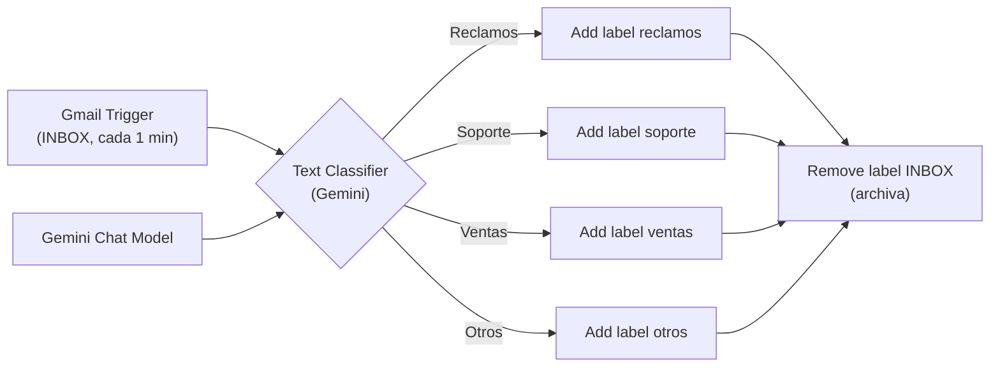

# 📧 Clasificación de Correo con IA

Automatización que revisa los correos que llegan a tu bandeja de entrada y los **clasifica con Gemini** en 4 categorías —reclamos, soporte, ventas y otros—, les aplica el label correspondiente en Gmail y los archiva fuera de la bandeja. Sin escribir una línea de código de clasificación: las categorías se describen en lenguaje natural.

---

## 🧠 Cómo funciona

1. **Gmail Trigger** consulta la bandeja (`INBOX`) **cada minuto**.
2. El **Text Classifier** envía `asunto + cuerpo` del correo a **Gemini**, que decide en cuál de las 4 categorías encaja.
3. Según la salida elegida, se aplica el **label de Gmail** correspondiente (`reclamos`, `soporte`, `ventas` u `otros`).
4. Todas las ramas convergen en **Remove label from message**, que quita el label `INBOX`: el correo queda **etiquetado y archivado**, fuera de la bandeja.

---

## 🔧 Flujo nodo a nodo (8 nodos)

| # | Nodo | Tipo | Función |
|---|---|---|---|
| 1 | `Gmail_Entrada` | Gmail Trigger | Consulta la bandeja cada minuto (filtro: `INBOX`) |
| 2 | `Text Classifier` | Text Classifier | Clasifica `asunto + texto` en 4 categorías con Gemini |
| 3 | `Google Gemini Chat Model` | Chat Model | Modelo que hace la clasificación |
| 4 | `Add label reclamos to email` | Gmail | Etiqueta el correo como **Reclamos** (quejas/inconformidades) |
| 5 | `Add label soporte to email` | Gmail | Etiqueta como **Soporte** (ayuda técnica/guía) |
| 6 | `Add label ventas to email` | Gmail | Etiqueta como **Ventas** (compra de productos/servicios) |
| 7 | `Add label otros to email` | Gmail | Etiqueta como **Otros** (lo que no encaja) |
| 8 | `Remove label from message` | Gmail | Quita `INBOX` → el correo queda archivado |

Categorías (definidas en lenguaje natural en el nodo clasificador, fáciles de editar):

- **Reclamos** — el usuario expresa una queja o inconformidad sobre un servicio o producto.
- **Soporte** — solicitud de ayuda técnica o guía para resolver un problema.
- **Ventas** — mensaje relacionado con la compra de productos o servicios.
- **Otros** — consulta o mensaje que no encaja en las categorías anteriores.

---

## 📋 Requisitos

- **n8n** self-hosted (este entorno corre con Docker).
- **Credencial OAuth2 de Gmail** con acceso a la API de Gmail (lectura y modificación de labels).
- **API key de Google Gemini** para el Text Classifier.
- Los 4 labels creados previamente en tu Gmail (`reclamos`, `soporte`, `ventas`, `otros`).

## 🚀 Importar y configurar

1. En n8n: **Import from File** → `workflow.json`.
2. **Reconecta tus credenciales**: Gmail (Trigger + las 5 acciones) y Gemini Chat Model. El export viene deliberadamente **sin credenciales**.
3. **Re-selecciona tus labels** en los 4 nodos *Add label*: los `Label_...` que trae el archivo son IDs internos de la cuenta original y no existen en la tuya.
4. **Activa** el workflow (el Trigger solo funciona activo; cada ejecución procesa los correos nuevos de la bandeja).

## 🔐 Notas de seguridad

Este export está **sanitizado para publicación**:

- Bloques de credenciales eliminados (Gmail ×6, Gemini ×1).
- Sin datos personales, direcciones de correo ni contenido de mensajes.

Los valores reales **no** están en este repositorio; configúralos en tu propia instancia al importar.

## 📚 Lo aprendido

- **El nodo Text Classifier de n8n** categoriza con un LLM sin código: basta describir cada categoría en lenguaje natural (la descripción *es* la especificación).
- **Patrón de triage de bandeja**: clasificar → etiquetar → archivar (quitar `INBOX`). El orden importa: el label se aplica antes de sacarlo de la bandeja para no perderlo.
- **Los `labelIds` de Gmail son internos por cuenta** (`Label_…`): en cualquier export reutilizable hay que re-seleccionarlos al importar.
