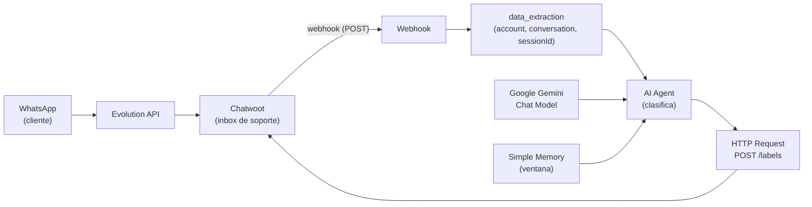
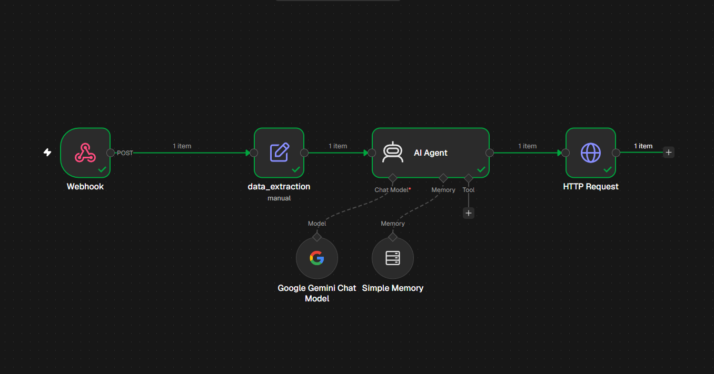
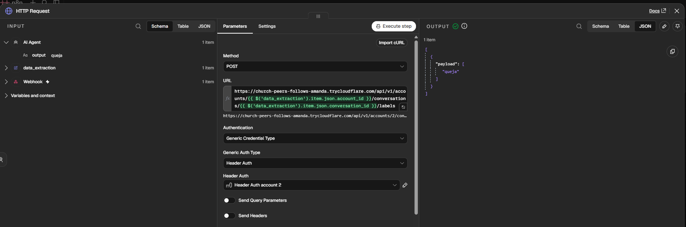

# 🎧 Sistema de Soporte con IA (WhatsApp → Chatwoot)

Automatización de atención al cliente: los mensajes de **WhatsApp** entran en **Chatwoot** (CRM de soporte, llegan vía Evolution API), un **webhook** avisa a n8n, un **AI Agent con Gemini** clasifica el mensaje en *venta*, *soporte* o *queja*, y n8n **aplica automáticamente el label correspondiente** a la conversación en Chatwoot. El equipo de soporte ve el CRM ya etiquetado, sin triage manual.

---

## 🧠 Cómo funciona

1. El cliente escribe por **WhatsApp** → Evolution API lo entrega en el **inbox de Chatwoot**.
2. Chatwoot dispara su **webhook** hacia el workflow de n8n (POST con account, conversation y contenido).
3. El nodo `data_extraction` extrae `account_id`, `conversation_id`, el `message` y usa el **número del remitente como `sessionId`**.
4. El **AI Agent** (Gemini + memoria de ventana) clasifica el mensaje con una instrucción de una sola palabra: `venta`, `soporte` o `queja`.
5. El **HTTP Request** llama a la API de Chatwoot (`POST /conversations/{id}/labels`) y etiqueta la conversación.

---

## 🔧 Flujo nodo a nodo (6 nodos)

| # | Nodo | Tipo | Función |
|---|---|---|---|
| 1 | `Webhook` | Webhook (POST) | Recibe los eventos de Chatwoot |
| 2 | `data_extraction` | Set | Extrae `account_id`, `conversation_id`, `message` y `sessionId` (teléfono del remitente) |
| 3 | `AI Agent` | AI Agent (LangChain) | Clasifica el mensaje: **venta / soporte / queja** |
| 4 | `Google Gemini Chat Model` | Chat Model | Modelo que hace la clasificación |
| 5 | `Simple Memory` | Buffer Window Memory | Memoria conversacional de la ventana |
| 6 | `HTTP Request` | HTTP Request | `POST` a la API de Chatwoot para aplicar el **label** a la conversación |

Prompt del clasificador (en lenguaje natural, fácil de editar):

> *"Eres un clasificador de mensajes. Tu objetivo es clasificar el siguiente mensaje en una única categoría: venta, soporte o queja. Responde únicamente con una sola palabra, en minúscula, sin signos de puntuación ni explicaciones."*

### Nodo HTTP Request (el cierre del circuito)

Envía el output del agente como label a Chatwoot — Method `POST`, auth **Header Auth** (token de cuenta de Chatwoot), URL con las expresiones `account_id` / `conversation_id` extraídas antes. Salida real de una ejecución: `{"payload": ["queja"]}`.

---

## 📋 Requisitos

- **n8n** self-hosted (este entorno corre con Docker) con el webhook accesible (túnel HTTPS para producción).
- **Chatwoot** con inbox de WhatsApp funcionando (llega vía Evolution API) — ver `../../evolutionApi` y `../../chatwoot`.
- Los 3 **labels creados en Chatwoot**: `venta`, `soporte`, `queja` (si no existen, la API devuelve error).
- **API key de Google Gemini** para el Chat Model.
- **Credencial Header Auth** en n8n con el *Account Token* de Chatwoot (Account Settings → APIs and Webhooks).
- El **webhook de Chatwoot** apuntando al webhook de n8n (Chatwoot → Account Settings → Webhooks → URL de producción del workflow).

## 🚀 Importar y configurar

1. En n8n: **Import from File** → `workflow.json`.
2. **Reconecta tus credenciales** (el export viene deliberadamente **sin credenciales**): Gemini Chat Model y Header Auth del HTTP Request.
3. **Reemplaza la URL placeholder** en el nodo *HTTP Request*: `https://TU-URL-DE-CHATWOOT.trycloudflare.com` por la `FRONTEND_URL` vigente de Chatwoot (la ves en `../../chatwoot/.env`; cambia con cada reinicio de su túnel → corre `../../chatwoot/tunnel.ps1` si dejó de responder).
4. **Copia la URL del Webhook** (Production) y pégala en Chatwoot → *Account Settings → Webhooks*.
5. Crea los 3 labels en Chatwoot y **activa** el workflow.

## 🔐 Notas de seguridad

Este export está **sanitizado para publicación**:

- Bloques de credenciales eliminados (Gemini ×1, Header Auth ×1).
- URL del túnel de Chatwoot reemplazada por un **placeholder** (las URLs de Quick Tunnel son efímeras y específicas de cada instalación).
- Sin datos personales, teléfonos ni tokens.

Los valores reales **no** están en este repositorio; configúralos en tu propia instancia al importar.

## 📚 Lo aprendido

- **El patrón webhook → clasificador → API de vuelta** es el corazón de un CRM asistido por IA: el LLM no responde al usuario, solo **decide** (una palabra) y un HTTP Request ejecuta la acción — simple, auditable y barato.
- **`sessionId` = número del remitente**: con eso el agente mantiene contexto por cliente sin bases de datos adicionales.
- **Chatwoot como canal + n8n como cerebro**: el CRM maneja bandeja, agentes y labels; n8n aporta la inteligencia. Desacoplados, cada uno se puede cambiar sin tocar el otro.
- Las **URLs de Quick Tunnel son efímeras**: en cualquier export reutilizable van como placeholder, nunca hardcodeadas.
