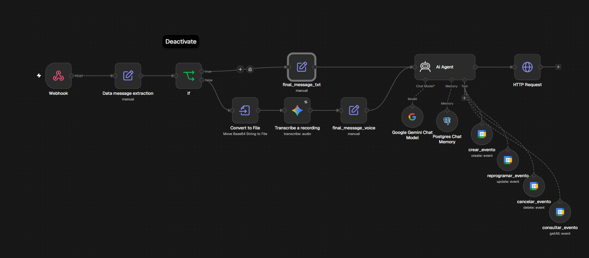
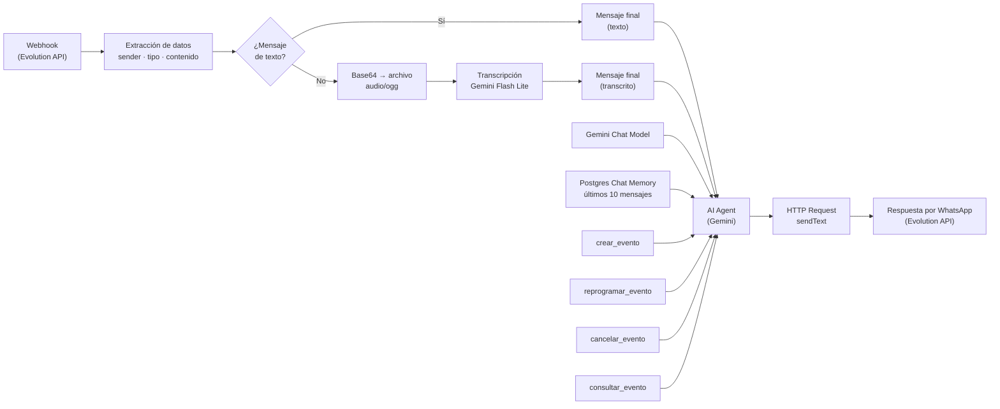
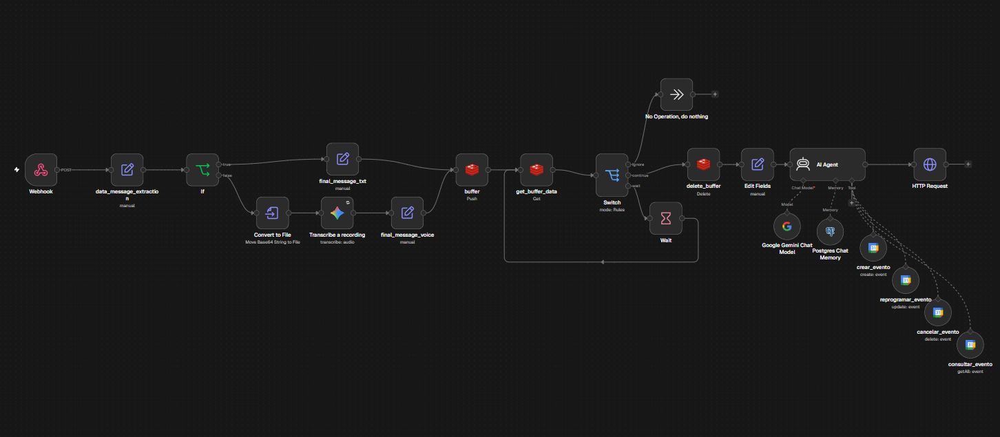

# 📅 01 — Asistente de Citas Multimodal para WhatsApp

Bot de WhatsApp que interpreta **texto y notas de voz** para agendar, reprogramar, cancelar y consultar citas en **Google Calendar** en tiempo real, con **memoria conversacional** en PostgreSQL. Actúa como un asistente (JARVIS) que responde en lenguaje natural por el mismo chat de WhatsApp.

---

## 🧠 Cómo funciona

1. **Evolution API** recibe el mensaje de WhatsApp (texto o nota de voz) y lo envía al **webhook** de n8n.
2. El flujo extrae el remitente, el tipo de mensaje y el contenido.
3. Si es **texto**, pasa directo al agente. Si es **nota de voz**, se convierte en archivo `audio/ogg` y se transcribe con **Gemini Flash Lite**.
4. Un **AI Agent (LangChain)** con **Gemini** como modelo decide qué hacer usando 4 herramientas de Google Calendar, manteniendo contexto con la memoria de los últimos 10 mensajes (PostgreSQL).
5. La respuesta conversacional se devuelve al usuario por WhatsApp vía **HTTP Request** a Evolution.

---

## 🔧 Flujo nodo a nodo (15 nodos)

| # | Nodo | Tipo | Función |
|---|---|---|---|
| 1 | `Webhook` | Webhook | Recibe los eventos de Evolution API (POST) |
| 2 | `Data message extraction` | Set | Extrae `sender`, `message_type`, `voice_message` (base64) y `text_message` |
| 3 | `If` | If | Decide rama: ¿`message_type = conversation`? → texto; si no → voz |
| 4 | `final_message_txt` | Set | Rama de texto: prepara el mensaje final |
| 5 | `Convert to File` | Convert to File | Convierte el base64 de la nota de voz en binario `audio/ogg` |
| 6 | `Transcribe a recording` | Google Gemini | Transcribe el audio con `gemini-3.5-flash-lite` |
| 7 | `final_message_voice` | Set | Rama de voz: prepara el mensaje transcrito |
| 8 | `AI Agent` | LangChain Agent | Orquesta: interpreta la intención y usa las herramientas; responde en lenguaje natural |
| 9 | `Google Gemini Chat Model` | Chat Model | Modelo del agente (Gemini) |
| 10 | `Postgres Chat Memory` | Memory | Memoria conversacional: últimos 10 mensajes por sesión en PostgreSQL |
| 11 | `crear_evento` | Google Calendar Tool | Cita nueva (start, end, summary, description) |
| 12 | `reprogramar_evento` | Google Calendar Tool | Mueve la fecha/hora de una cita existente |
| 13 | `cancelar_evento` | Google Calendar Tool | Elimina una cita |
| 14 | `consultar_evento` | Google Calendar Tool | Consulta citas (por ejemplo, "¿qué tengo esta semana?") |
| 15 | `HTTP Request` | HTTP Request | Envía la respuesta al usuario con `POST /message/sendText/{instancia}` de Evolution |

---

## 📋 Requisitos

- **n8n** self-hosted (este entorno corre con Docker).
- **Evolution API** con una instancia de WhatsApp vinculada (recibe y envía mensajes).
- **API key de Google Gemini** (transcripción de voz + modelo del agente).
- **Credenciales OAuth2 de Google Calendar** con acceso a tu calendario.
- **PostgreSQL** para la memoria conversacional (la tabla se crea automáticamente).

## 🚀 Importar y configurar

Este proyecto incluye **dos variantes del mismo asistente**:

| Archivo | Nodos | Diferencia |
|---|---|---|
| `Asistente Google Calendar.json` | 15 | Versión principal: memoria conversacional en **PostgreSQL** |
| `Asistente Google Calendar version redis.json` | 22 | Añade un **búfer temporal en Redis** (`buffer` → `Wait` → `Switch`) para descartar mensajes duplicados antes de procesarlos |

1. En n8n: **Import from File** → elige la variante que quieras.
2. **Reconecta tus credenciales** en los nodos que los requieren (Gemini ×2, Google Calendar ×4, nodo de memoria; en la variante Redis además la credencial de Redis). Los exports vienen deliberadamente **sin credenciales**.
3. Ajusta el **path del webhook** (viene como placeholder `asistente-citas`) y **activa** el workflow.
4. Apunta el webhook de tu instancia de Evolution hacia la URL de n8n (`Test` o `Production` según necesites).
5. Prueba enviando un texto y una nota de voz al número de WhatsApp.

## 🔐 Notas de seguridad

Los dos exports están **sanitizados para publicación**:

- Bloques de credenciales eliminados (Gemini, Google Calendar, Postgres y Redis).
- API key de Evolution → `TU_API_KEY_EVOLUTION`.
- Email personal del calendario → `tu-email@gmail.com`.
- Path/UUID real del webhook → `asistente-citas`.

Los valores reales **no** están en este repositorio; configuralos en tu propia instancia al importar.

## 📚 Lo aprendido

- **La memoria depende del `sessionId`**: debe identificar al **usuario** (`remoteJid`), no al mensaje (`key.id`). Con el id del mensaje, cada mensaje abre una sesión nueva y el asistente no recuerda nada — y **todas** las ramas (texto y voz) deben definir el mismo `sessionId`, si no la rama que lo omite falla con *"No session ID found"*.
- **Un export de n8n no es anónimo**: aunque no traiga los secretos, arrastra IDs y nombres de credenciales, API keys escritas dentro de headers, correos en parámetros y UUIDs de webhook. Antes de publicar: credenciales → fuera, secretos → placeholder, email → genérico, webhook → nombre legible.
- **Tool calling con Gemini es estricto**: el error `400 — function call turn comes immediately after a user turn...` aparece cuando la ventana de memoria (10 mensajes aquí) deja un `functionCall` huérfano en el historial; se resuelve limpiando la sesión o ampliando la ventana.
- **PostgreSQL vs Redis aquí**: Postgres alcanza para la memoria simple (15 nodos); en la variante Redis el servicio se usa como **búfer de mensajes** (22 nodos: guardar → esperar → comparar → descartar duplicados), no como memoria del agente.
